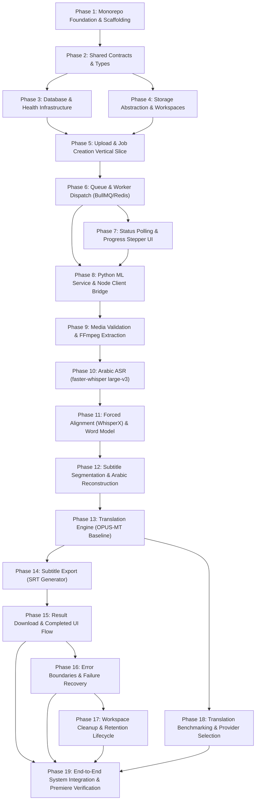

# Master Implementation Roadmap: Arabic to English Subtitle Application

This document defines the master, end-to-end implementation roadmap for the Arabic-to-English subtitle web application. It derives directly from the system specifications in [`Docs/`](Docs), establishing an Agile sequence of 19 self-contained, testable, vertical development phases.

---

## 1. Architectural Principles & Implementation Rules

1. **Strict Service Boundaries**:
   - **Frontend (`apps/web`)**: React + TypeScript + Vite + Tailwind CSS. Owns UI, file selection, stage progress display, error presentation, and `.srt` download. Contains zero ML or media processing logic.
   - **Backend API (`apps/api`)**: Node.js + Express + TypeScript + Bun + Drizzle ORM. Owns public API, upload validation, PostgreSQL job persistence, BullMQ job queue orchestration, local storage sandboxing, and Python ML service invocation.
   - **ML Service (`services/ml-service`)**: Python + FastAPI. Owns media probing (`ffprobe`), audio extraction (`ffmpeg`), speech recognition (`faster-whisper`), forced alignment (`whisperx`), word normalization, subtitle segmentation, Arabic-to-English translation (`Helsinki-NLP/opus-mt-ar-en` and benchmarked candidates), and SRT export.
2. **Package Management**:
   - All JS/TS package management strictly uses **Bun** (`bun install`, `bun run`).
   - Do not use npm, pnpm, or yarn.
3. **Git Branching Strategy**:
   - Every phase/feature is implemented on an isolated branch formatted `farooq/<feature-name>`.
   - The initial project foundation phase uses `farooq/scaffolding` (or `farooq/foundation`).
   - Never commit or merge directly into `main` without Farooq's explicit approval.
4. **Asynchronous Architecture**:
   - No HTTP request stays open during media or ML processing.
   - Work is enqueued to BullMQ (backed by Redis), executed asynchronously, and polled by the frontend via `GET /api/jobs/:jobId`.
5. **No Fabricated Progress**:
   - Progress UI is strictly stage-based reflecting the 10 canonical job states. No synthetic percentage progress bars.
6. **Data Contracts & Traceability**:
   - Segment and word IDs are immutable application keys (`job_`, `word_`, `seg_`, `artifact_`).
   - Timestamps are application-controlled floating-point seconds. Translation engines translate text only and have zero authority over IDs or timestamps.

---

## 2. Canonical Job Lifecycle & Processing States

The application transitions through the following 10 canonical processing states (or `failed` at any stage):

```text
queued
  ↓
validating_media
  ↓
extracting_audio
  ↓
transcribing
  ↓
aligning
  ↓
normalizing
  ↓
segmenting
  ↓
translating
  ↓
exporting
  ↓
completed
```

---

## 3. Phased Implementation Roadmap

---

### Phase 1 — Monorepo Foundation & Scaffolding

**Objective**  
Establish the Bun monorepo workspace containing `apps/web`, `apps/api`, `services/ml-service`, and `packages/shared-types`, accompanied by Docker Compose for local PostgreSQL and Redis.

**Why this phase exists**  
Establishes clean repository boundaries, workspace linkages, shared TypeScript configs, and reproducible containerized infrastructure before writing application logic.

**Scope**
- Root: `package.json` (workspaces), `bun.lockb`, `.gitignore`, `docker-compose.yml` (PostgreSQL 16, Redis 7).
- Git branch: `farooq/scaffolding`.
- TypeScript: root `tsconfig.json` with strict type checking and workspace path references.
- Python: virtual environment (`.venv`), base `pyproject.toml` or `requirements.txt` for `services/ml-service`.

**Files / Modules Likely Affected**
- `package.json`
- `docker-compose.yml`
- `.gitignore`
- `tsconfig.json`
- `apps/web/package.json`
- `apps/api/package.json`
- `packages/shared-types/package.json`
- `services/ml-service/requirements.txt`

**Implementation Tasks**
1. Initialize Bun monorepo configuration with workspaces for `apps/*` and `packages/*`.
2. Author root `docker-compose.yml` defining `postgres` (port 5432) with a persistent volume and `redis` (port 6379).
3. Setup shared base `tsconfig.json` enforcing strict null checks and ESNext target.
4. Setup Python virtual environment in `services/ml-service` with pinned development dependencies.
5. Create repository scripts (`scripts/run-local.ps1` or commands in root `package.json`).

**Contracts / Interfaces Introduced**
- Monorepo package references (`@kaol/shared-types`).
- Service port assignments:
  - `apps/api`: `http://localhost:3000`
  - `apps/web`: `http://localhost:5173`
  - `services/ml-service`: `http://localhost:8000`
  - PostgreSQL: `localhost:5432`
  - Redis: `localhost:6379`

**Testing / Verification**
- Run `bun install` at root: resolves and links all workspace packages cleanly without warnings.
- Run `docker compose up -d`: PostgreSQL responds to `pg_isready -h localhost -p 5432`, and Redis responds to `redis-cli ping` with `PONG`.
- Verify Python virtual environment activates and imports core standard libraries.

**Acceptance Criteria**
- [ ] Monorepo workspace is configured and `bun install` completes without errors.
- [ ] PostgreSQL and Redis run locally via Docker Compose.
- [ ] Work is committed to branch `farooq/scaffolding`.

**Dependencies**  
None.

---

### Phase 2 — Shared Data Contracts & Types

**Objective**  
Define the project-owned TypeScript types in `packages/shared-types` and corresponding Pydantic schemas in `services/ml-service/app/schemas/`.

**Why this phase exists**  
Establishes the single source of truth for cross-language data contracts between React, Node.js, and Python ML Service before building API routes or storage logic.

**Scope**
- TypeScript (`packages/shared-types`): `jobs.ts`, `words.ts`, `segments.ts`, `translations.ts`, `artifacts.ts`, `errors.ts`.
- Python (`services/ml-service/app/schemas/`): `job.py`, `word.py`, `segment.py`, `translation.py`, `artifact.py`, `errors.py`.

**Files / Modules Likely Affected**
- `packages/shared-types/src/index.ts`
- `packages/shared-types/src/jobs.ts`
- `packages/shared-types/src/words.ts`
- `packages/shared-types/src/segments.ts`
- `packages/shared-types/src/translations.ts`
- `packages/shared-types/src/artifacts.ts`
- `packages/shared-types/src/errors.ts`
- `services/ml-service/app/schemas/*`

**Implementation Tasks**
1. Implement canonical `JobStatus` union:
   `queued | validating_media | extracting_audio | transcribing | aligning | normalizing | segmenting | translating | exporting | completed | failed`.
2. Implement `CanonicalWord` model (`id`, `textRaw`, `textNormalized`, `start`, `end`, `asrProbability`, `timingSource`, `alignmentStatus`, `sourceSegmentId`).
3. Implement `SubtitleSegment` model (`id`, `sequence`, `start`, `end`, `duration`, `arabic`, `wordIds`, `timingQuality`, `averageAsrProbability`).
4. Implement translation input/output contracts (`id`, `arabic` -> `id`, `english`).
5. Implement `TranslatedSegment` model (merging English translation onto original segment timestamps).
6. Implement public error schema: `{ error: { code: string, message: string } }`.
7. Mirror schemas in Python Pydantic with snake_case internal fields and camelCase aliases for boundary serialization.

**Contracts / Interfaces Introduced**
- Public JSON uses `camelCase`; internal Python uses `snake_case`.
- Timestamps are floating-point seconds (`start >= 0`, `end > start`).
- Explicit ID prefixes: `job_`, `word_`, `seg_`, `artifact_`.

**Testing / Verification**
- Unit test in `packages/shared-types` compiling types (`tsc --noEmit`).
- Unit tests in `services/ml-service` validating Pydantic models against sample JSON fixtures from [`Data_contract.md`](Docs/Data_contract.md).

**Acceptance Criteria**
- [ ] TypeScript types compile without errors.
- [ ] Pydantic models successfully deserialize camelCase JSON fixtures and serialize with identical keys.
- [ ] ID prefix constraints and non-negative timestamp validations are enforced.

**Dependencies**  
Phase 1.

---

### Phase 3 — Database Foundation & Health Infrastructure

**Objective**  
Configure PostgreSQL persistence in `apps/api` using Drizzle ORM, create database migrations for `jobs` and `artifacts`, and provide system health check endpoints.

**Why this phase exists**  
Sets up metadata persistence and health monitoring so subsequent vertical slices can reliably save and inspect job state transitions.

**Scope**
- Backend: Express app initialization, Drizzle ORM configuration, schema definitions (`jobs`, `artifacts`), migrations script, health route (`GET /api/health`).
- Frontend: Minimal React shell confirming backend API connectivity.

**Files / Modules Likely Affected**
- `apps/api/src/main.ts`
- `apps/api/src/config/env.ts`
- `apps/api/src/database/schema/jobs.ts`
- `apps/api/src/database/schema/artifacts.ts`
- `apps/api/src/database/client/db.ts`
- `apps/api/src/database/drizzle.config.ts`
- `apps/api/src/modules/health/health.controller.ts`
- `apps/web/src/App.tsx`

**Implementation Tasks**
1. Define Drizzle schema for `jobs` (`id`, `status`, `source_filename`, `source_media_reference`, `result_reference`, `error_code`, `error_message`, `created_at`, `updated_at`, `completed_at`).
2. Define Drizzle schema for `artifacts` (`id`, `job_id`, `type`, `filename`, `created_at`).
3. Generate and run Drizzle migrations against PostgreSQL.
4. Implement `JobRepository` with atomic `createJob`, `updateJobStatus`, and `getJobById` methods.
5. Implement `GET /api/health` checking database query execution and Redis ping.
6. Connect minimal React frontend to query `GET /api/health` on mount and display status.

**Contracts / Interfaces Introduced**
- `GET /api/health` response:
  ```json
  { "status": "ok", "services": { "database": "connected", "redis": "connected" } }
  ```

**Testing / Verification**
- Automated integration test executing Drizzle migration against test database.
- Repository test creating, reading, and updating job records.
- API test verifying `GET /api/health` returns HTTP 200.

**Acceptance Criteria**
- [ ] Drizzle migrations execute cleanly.
- [ ] Repository persists job status transitions into PostgreSQL.
- [ ] `GET /api/health` returns status of connected services.

**Dependencies**  
Phase 2.

---

### Phase 4 — Local Storage Abstraction & Job Workspaces

**Objective**  
Implement the `StorageService` interface with `LocalStorageService` in `apps/api` and a matching workspace manager in `services/ml-service` to manage `data/jobs/{jobId}/`.

**Why this phase exists**  
Provides sandboxed, isolated per-job directories on the local filesystem while abstracting storage calls so future object storage (S3/R2) requires zero application rewrites.

**Scope**
- Backend: `StorageService` contract and `LocalStorageService` (`save`, `get`, `exists`, `delete`, `createJobWorkspace`, `cleanupJob`).
- Python: `app/media/workspace.py` managing local job paths.

**Files / Modules Likely Affected**
- `apps/api/src/storage/storage.interface.ts`
- `apps/api/src/storage/local-storage.service.ts`
- `apps/api/src/config/env.ts`
- `services/ml-service/app/media/workspace.py`

**Implementation Tasks**
1. Define `StorageService` interface in Node.
2. Implement `LocalStorageService` creating `data/jobs/{jobId}/` and supporting arbitrary file extensions (`input.<ext>`).
3. Add strict path sanitization to prevent directory traversal attacks (reject paths containing `..` or illegal characters).
4. Implement Python `JobWorkspace` class managing standardized relative paths:
   - `input.<validated-extension>`
   - `audio.wav`
   - `words.json`
   - `segments.json`
   - `translations.json`
   - `output.srt`
5. Align root directory paths across Node and Python via `STORAGE_LOCAL_ROOT` / `WORKSPACE_DIR` environment variables.

**Contracts / Interfaces Introduced**
- `StorageService` contract: `createJobWorkspace(jobId)`, `save(jobId, filename, stream)`, `get(jobId, filename)`, `delete(jobId, filename)`, `cleanupJob(jobId)`.
- Directory convention: `data/jobs/{jobId}/input.<ext>`.

**Testing / Verification**
- Unit tests verifying path traversal prevention (`../../etc/passwd` throws explicit error).
- Workspace creation and file read/write tests in Node and Python.

**Acceptance Criteria**
- [ ] File reads and writes are strictly restricted to `data/jobs/{jobId}/`.
- [ ] Workspace creates expected per-job directory tree.
- [ ] Path traversal attempts fail safely with descriptive errors.

**Dependencies**  
Phase 3.

---

### Phase 5 — Media Upload & Job Creation Vertical Slice

**Objective**  
Build the media upload flow: file selection in React, multipart upload to Express, validation, saving media as `data/jobs/{jobId}/input.<validated-extension>`, and initial job record persistence.

**Why this phase exists**  
Allows users to upload Arabic media (MP4, WAV, MP3, M4A, MOV) and receive an authoritative `jobId`.

**Scope**
- Frontend: `MediaDropzone`, file selection card, upload progress feedback, API client.
- Backend: `POST /api/jobs` handling `multipart/form-data`, file extension and size validation, generating `job_<uuid>`, persisting record with status `queued`.

**Files / Modules Likely Affected**
- `apps/web/src/features/upload/MediaDropzone.tsx`
- `apps/web/src/features/upload/UploadForm.tsx`
- `apps/web/src/lib/api/jobs.ts`
- `apps/api/src/modules/jobs/jobs.controller.ts`
- `apps/api/src/modules/jobs/jobs.service.ts`
- `apps/api/src/middleware/upload.middleware.ts`

**Implementation Tasks**
1. Configure Express multipart upload middleware with size limit (`MAX_UPLOAD_SIZE_MB`, default 200MB).
2. Validate uploaded file extensions against supported whitelist: `.mp4`, `.wav`, `.mp3`, `.m4a`, `.mov`.
3. Generate server-controlled `jobId` (`job_<nanoid>`).
4. Save file to `data/jobs/{jobId}/input.<validated-extension>` via `LocalStorageService`.
5. Persist job in PostgreSQL with `status: "queued"`.
6. Implement React drag-and-drop `MediaDropzone` with file type checking and submit state.
7. Redirect user to `/jobs/:jobId` upon successful job creation.

**Contracts / Interfaces Introduced**
- `POST /api/jobs` (multipart with `file` field):
  ```json
  { "jobId": "job_123456", "status": "queued" }
  ```

**Testing / Verification**
- Integration test posting a test MP4 and WAV file to `POST /api/jobs`.
- Verify database record is created with `status: "queued"` and `source_filename`.
- Verify file is saved in `data/jobs/job_123456/input.mp4`.
- Manual browser test dragging a file and verifying navigation to `/jobs/:jobId`.

**Acceptance Criteria**
- [ ] Uploading valid media returns HTTP 201 with `{ jobId, status: "queued" }`.
- [ ] File is saved with its original validated extension inside the job workspace.
- [ ] Unsupported extensions or oversized files return HTTP 400 with safe error code.

**Dependencies**  
Phase 4.

---

### Phase 6 — Queue Infrastructure & Asynchronous Worker Dispatch

**Objective**  
Integrate BullMQ + Redis in `apps/api` to decouple job processing from the HTTP request/response cycle.

**Why this phase exists**  
Long-running transcription and translation cannot block HTTP requests; queue handles execution, retries, and worker concurrency safely.

**Scope**
- Backend: BullMQ queue setup, worker consumer, payload types, state synchronization.

**Files / Modules Likely Affected**
- `apps/api/src/queue/job.queue.ts`
- `apps/api/src/queue/job.worker.ts`
- `apps/api/src/queue/job.producer.ts`
- `apps/api/src/modules/jobs/jobs.service.ts`

**Implementation Tasks**
1. Initialize BullMQ Queue (`transcription-jobs`) and connection to Redis.
2. In `JobsService.createJob`, enqueue BullMQ job `{ jobId, sourcePath }` immediately after database insertion.
3. Build BullMQ worker processor shell:
   - fetches job from database.
   - verifies current state is `queued`.
   - runs mock stage transitions (`validating_media` -> `completed`).
   - updates database record at each step.
4. Ensure worker idempotency: duplicate job events for the same job ID must not corrupt database state.

**Contracts / Interfaces Introduced**
- BullMQ Job Payload:
  ```json
  { "jobId": "job_123456", "sourcePath": "data/jobs/job_123456/input.mp4" }
  ```

**Testing / Verification**
- Automated integration test creating a job via service, verifying message arrival in BullMQ, and asserting worker executes to completion.

**Acceptance Criteria**
- [ ] `POST /api/jobs` responds immediately (<200ms) without waiting for processing.
- [ ] Worker picks up job payload from Redis and transitions state in PostgreSQL.
- [ ] Enqueueing a duplicate job ID does not create inconsistent records.

**Dependencies**  
Phase 5.

---

### Phase 7 — Job Status Polling & Progress UI

**Objective**  
Implement `GET /api/jobs/:jobId` and build the frontend processing screen with non-overlapping polling and a stage-based stepper UI.

**Why this phase exists**  
Gives users clear, truthful visibility into the current stage of their job without fabricating artificial percentages.

**Scope**
- Backend: `GET /api/jobs/:jobId` endpoint returning canonical status and stage progress.
- Frontend: `/jobs/:jobId` route, TanStack Query polling hook (3000ms), `JobStageList`, `JobStatusCard`.

**Files / Modules Likely Affected**
- `apps/api/src/modules/jobs/jobs.controller.ts`
- `apps/web/src/features/jobs/JobStatusPage.tsx`
- `apps/web/src/features/jobs/JobStageList.tsx`
- `apps/web/src/features/jobs/JobStatusCard.tsx`
- `apps/web/src/hooks/useJobStatus.ts`

**Implementation Tasks**
1. Implement `GET /api/jobs/:jobId` returning `JobResponse` (`jobId`, `status`, `progress: { stage }`, `error`).
2. Build TanStack Query hook polling `/api/jobs/:jobId` every 3000ms while status is non-terminal.
3. Guarantee non-overlapping requests (disable refetch while a poll request is in flight).
4. Terminate polling immediately when status is `completed` or `failed`.
5. Build `JobStageList` stepper component rendering all canonical stages with clear active/completed/pending indicators and human-readable labels.

**Contracts / Interfaces Introduced**
- `GET /api/jobs/:jobId` response:
  ```json
  {
    "jobId": "job_123456",
    "status": "validating_media",
    "progress": { "stage": "validating_media" },
    "error": null
  }
  ```

**Testing / Verification**
- Frontend unit tests asserting polling terminates on `completed` and `failed`.
- Browser test verifying stepper advances as worker transitions through mock states.

**Acceptance Criteria**
- [ ] Stepper highlights the exact active stage corresponding to backend state.
- [ ] Polling stops automatically upon terminal state.
- [ ] No synthetic percentage progress bars are rendered.

**Dependencies**  
Phase 6.

---

### Phase 8 — Python ML Service Foundation & Orchestration Bridge

**Objective**  
Establish the FastAPI application structure, configure model loading lifecycles, and create the invocation bridge between the Node API worker and Python ML Service.

**Why this phase exists**  
Establishes the communication layer connecting Node's BullMQ worker to the Python ML environment while encapsulating all media and model execution inside Python.

**Scope**
- Python: FastAPI app skeleton, `/health`, `/api/processing/jobs` endpoint, configuration via `pydantic-settings`.
- Backend: `MlServiceClient` in `apps/api`.
- Architectural review: Evaluate stage communication mechanism (Option A internal callback webhook vs Option B SSE vs Option C discrete stage endpoints) against the local architecture before implementation.

**Files / Modules Likely Affected**
- `services/ml-service/app/main.py`
- `services/ml-service/app/config/settings.py`
- `services/ml-service/app/api/health.py`
- `services/ml-service/app/api/processing.py`
- `services/ml-service/app/pipeline/full_pipeline.py`
- `apps/api/src/clients/ml-service/ml-service.client.ts`
- `apps/api/src/queue/job.worker.ts`

**Implementation Tasks**
1. Implement FastAPI application with structured JSON logging and health endpoint.
2. Evaluate stage progress mechanism in the Phase 8 detailed plan: select the simplest reliable option for the local environment (e.g., Python callback to Node `POST /api/internal/jobs/:jobId/stage`).
3. Implement `POST /api/processing/jobs` in FastAPI accepting `{ jobId: string, workspaceDir: string }`.
4. Implement `MlServiceClient` in Node calling FastAPI's processing endpoint.
5. Replace mock transitions in BullMQ worker with live call to Python ML Service.

**Contracts / Interfaces Introduced**
- ML Service API: `POST /api/processing/jobs`:
  ```json
  { "jobId": "job_123456", "workspaceDir": "data/jobs/job_123456" }
  ```
- Node internal stage update: `POST /api/internal/jobs/:jobId/stage`:
  ```json
  { "stage": "transcribing" }
  ```

**Testing / Verification**
- Integration test: Node worker triggers FastAPI processing endpoint; FastAPI notifies Node of stage updates; database reflects transitions.

**Acceptance Criteria**
- [ ] Node worker successfully triggers Python ML Service.
- [ ] Stage updates flow from Python back to PostgreSQL.
- [ ] ML implementation details remain completely isolated inside Python.

**Dependencies**  
Phase 7.

---

### Phase 9 — Media Validation & FFmpeg Audio Extraction

**Objective**  
Implement media probing with `ffprobe` and extract audio into 16 kHz mono 16-bit PCM WAV using `ffmpeg`.

**Why this phase exists**  
Converts diverse incoming media formats into standard PCM audio required by Whisper and WhisperX, while validating decodability and rejecting corrupt media early.

**Scope**
- Python: `app/media/validator.py`, `app/media/ffprobe.py`, `app/media/ffmpeg.py`.
- Pipeline stages: `validating_media` -> `extracting_audio`.

**Files / Modules Likely Affected**
- `services/ml-service/app/media/validator.py`
- `services/ml-service/app/media/ffprobe.py`
- `services/ml-service/app/media/ffmpeg.py`
- `services/ml-service/app/pipeline/stages.py`

**Implementation Tasks**
1. Implement `ffprobe.py` extracting container format, duration, audio stream existence, codec, sample rate, and channels.
2. Implement `validator.py` with the following strict constraints:
   - media is decodable.
   - audio stream exists.
   - duration is non-zero (`duration > 0`).
   - duration and file size are within configured limits.
   *(Note: Silent media is not rejected here; subsequent VAD/ASR handles speech detection).*
3. Implement `ffmpeg.py` audio extraction command:
   `ffmpeg -y -i input.<ext> -vn -ac 1 -ar 16000 -c:a pcm_s16le audio.wav`.
4. Integrate validation and extraction into pipeline, emitting `validating_media` and `extracting_audio` stage events.

**Contracts / Interfaces Introduced**
- `MediaMetadata` schema:
  ```json
  {
    "durationSeconds": 65.42,
    "container": "mp4",
    "audioCodec": "aac",
    "sampleRate": 48000,
    "channels": 2
  }
  ```

**Testing / Verification**
- Unit tests probing test fixtures (MP4, WAV, MP3, M4A, MOV).
- Test corrupted/invalid media file throws explicit `MEDIA_VALIDATION_FAILED` error.
- Verify extracted `audio.wav` has exact properties: PCM s16le, 16000 Hz, mono.

**Acceptance Criteria**
- [ ] Valid media formats extract into `data/jobs/{jobId}/audio.wav`.
- [ ] Corrupt or audio-less files fail cleanly during `validating_media`.
- [ ] Extraction executes via non-blocking asynchronous process invocation.

**Dependencies**  
Phase 8.

---

### Phase 10 — Arabic ASR with faster-whisper

**Objective**  
Implement Arabic automatic speech recognition using `faster-whisper` `large-v3` with Voice Activity Detection (VAD).

**Why this phase exists**  
Transcribes spoken Arabic from the extracted audio into raw Arabic text and segment timestamps.

**Scope**
- Python: `app/transcription/service.py`, `app/transcription/interfaces.py`, `app/providers/transcription/faster_whisper.py`.
- Pipeline stage: `transcribing`.

**Files / Modules Likely Affected**
- `services/ml-service/app/transcription/interfaces.py`
- `services/ml-service/app/transcription/service.py`
- `services/ml-service/app/transcription/mappers.py`
- `services/ml-service/app/providers/transcription/faster_whisper.py`
- `services/ml-service/app/config/settings.py`

**Implementation Tasks**
1. Define `Transcriber` interface in Python.
2. Implement `FasterWhisperTranscriber` loading `large-v3` with `device="cpu"` and `compute_type="int8"`.
3. Configure transcription parameters:
   - `language="ar"`
   - `task="transcribe"`
   - `beam_size=5`
   - `vad_filter=True`
   - `vad_parameters={"min_silence_duration_ms": 500}`
   - `word_timestamps=True`
4. Implement model lifecycle management: load model once at service startup and reuse across requests.
5. Map raw library segments into project-owned `RawTranscript` internal schema.

**Contracts / Interfaces Introduced**
- `Transcriber` interface: `transcribe(audio_path: Path) -> RawTranscript`.
- `RawTranscript` internal schema.

**Testing / Verification**
- Unit test mocking faster-whisper output to verify mapping.
- Integration test on a short (5-second) Arabic audio fixture verifying non-empty Arabic transcript.

**Acceptance Criteria**
- [ ] Audio is transcribed into Arabic text without translation.
- [ ] Model is reused without being reloaded per job.
- [ ] VAD suppresses non-speech audio intervals.

**Dependencies**  
Phase 9.

---

### Phase 11 — Forced Alignment with WhisperX & Canonical Word Generation

**Objective**  
Perform forced phoneme/word alignment using WhisperX on normalized audio and the recognized Arabic transcript, outputting canonical timed words.

**Why this phase exists**  
Refines word-level start and end timestamps so subtitle cues synchronize precisely with speech.

**Scope**
- Python: `app/alignment/service.py`, `app/alignment/fallback.py`, `app/providers/alignment/whisperx.py`.
- Pipeline stage: `aligning`.

**Files / Modules Likely Affected**
- `services/ml-service/app/alignment/interfaces.py`
- `services/ml-service/app/alignment/service.py`
- `services/ml-service/app/alignment/fallback.py`
- `services/ml-service/app/alignment/mappers.py`
- `services/ml-service/app/providers/alignment/whisperx.py`

**Implementation Tasks**
1. Define `Aligner` interface in Python.
2. Implement `WhisperXAligner` loading Arabic alignment dictionary/model.
3. Run alignment on `audio.wav` and recognized Arabic transcript.
4. Implement timing fallback logic:
   - 1st priority: WhisperX forced alignment.
   - 2nd priority: faster-whisper word timing.
   - 3rd priority: linear estimation (only when safe).
   - 4th priority: unaligned (null timestamps).
5. Map words into canonical `CanonicalWord` schema (`id`, `textRaw`, `textNormalized`, `start`, `end`, `asrProbability`, `timingSource`, `alignmentStatus`).
6. Write word list to `data/jobs/{jobId}/words.json`.

**Contracts / Interfaces Introduced**
- Canonical Word schema:
  ```json
  {
    "id": "word_000001",
    "textRaw": "السلام",
    "textNormalized": "السلام",
    "start": 4.18,
    "end": 4.71,
    "asrProbability": 0.98,
    "timingSource": "whisperx",
    "alignmentStatus": "aligned",
    "sourceSegmentId": 0
  }
  ```

**Testing / Verification**
- Unit test verifying fallback order when alignment tokens fail.
- Assert all aligned or estimated words satisfy `start >= 0` and `end > start`.
- Assert unaligned words (with null timing) do not crash the pipeline.

**Acceptance Criteria**
- [ ] Every word has a unique `word_xxxxxx` ID.
- [ ] Aligned words have accurate start/end timestamps.
- [ ] An unaligned token falls back safely without failing the job.
- [ ] `data/jobs/{jobId}/words.json` is persisted.

**Dependencies**  
Phase 10.

---

### Phase 12 — Word Normalization, Subtitle Segmentation & Arabic Text Reconstruction

**Objective**  
Execute conservative word normalization, group canonical words into logical subtitle segments using boundary scoring, and reconstruct readable Arabic text.

**Why this phase exists**  
Converts a continuous stream of individual words into natural, readable subtitle units sized for human viewing prior to translation.

**Scope**
- Python: `app/normalization/arabic.py`, `app/segmentation/service.py`, `app/segmentation/boundary_scoring.py`, `app/segmentation/reconstruction.py`.
- Pipeline stages: `normalizing` -> `segmenting`.
- Explicit internal sequence:
  ```text
  aligned words
      ↓
  conservative word normalization
      ↓
  segmentation
      ↓
  punctuation-aware reconstruction
  ```

**Files / Modules Likely Affected**
- `services/ml-service/app/normalization/arabic.py`
- `services/ml-service/app/segmentation/boundary_scoring.py`
- `services/ml-service/app/segmentation/reconstruction.py`
- `services/ml-service/app/segmentation/service.py`

**Implementation Tasks**
1. Implement conservative word normalization in `app/normalization/arabic.py` (tatweel removal, whitespace cleanup, preserving letters and diacritics where appropriate).
2. Implement boundary scoring in `boundary_scoring.py` taking into account:
   - strong punctuation (`.`, `؟`, `!`) and medium punctuation (`،`, `؛`, `:`).
   - silence gaps between words (`>=700ms` strong pause, `>=400ms` medium pause).
   - duration limits (1.0s target min, 5.0s preferred max, 6.5s hard max).
   - soft limits (12 words, 70 characters).
3. Compute segment start and end strictly from boundary words (`first_word.start`, `last_word.end`).
4. Reconstruct punctuation-aware Arabic text (correct spacing around commas and periods; no blind `" ".join(tokens)`).
5. Generate `SubtitleSegment` records (`id`, `sequence`, `start`, `end`, `duration`, `arabic`, `wordIds`, `timingQuality`).
6. Save `data/jobs/{jobId}/segments.json`.

**Contracts / Interfaces Introduced**
- `SubtitleSegment` schema:
  ```json
  {
    "id": "seg_000001",
    "sequence": 1,
    "start": 4.18,
    "end": 7.92,
    "duration": 3.74,
    "arabic": "السلام عليكم ورحمة الله وبركاته",
    "wordIds": ["word_000001", "word_000002"],
    "timingQuality": "aligned"
  }
  ```

**Testing / Verification**
- Unit tests verifying pause-based splitting on audio gaps >=700ms.
- Unit tests verifying duration constraints (segmenting text before exceeding 6.5 seconds).
- Assert Arabic punctuation attaches correctly to previous words without leading spaces.

**Acceptance Criteria**
- [ ] Segments stay within target subtitle lengths (1.0s–6.5s).
- [ ] Segment start/end timestamps derive from valid word boundaries.
- [ ] `wordIds` maintain complete traceability back to canonical words.
- [ ] `data/jobs/{jobId}/segments.json` is persisted.

**Dependencies**  
Phase 11.

---

### Phase 13 — Arabic-to-English Translation Engine (OPUS-MT Baseline)

**Objective**  
Implement the common `Translator` interface and build the OPUS-MT baseline provider (`Helsinki-NLP/opus-mt-ar-en`) with strict output validation.

**Why this phase exists**  
Translates Arabic subtitle segments into natural English while guaranteeing that timestamps and segment IDs remain completely controlled by the application.

**Scope**
- Python: `app/translation/service.py`, `app/translation/interfaces.py`, `app/translation/batching.py`, `app/translation/validation.py`, `app/providers/translation/opus.py`.
- Pipeline stage: `translating`.

**Files / Modules Likely Affected**
- `services/ml-service/app/translation/interfaces.py`
- `services/ml-service/app/translation/service.py`
- `services/ml-service/app/translation/batching.py`
- `services/ml-service/app/translation/validation.py`
- `services/ml-service/app/providers/translation/opus.py`
- `services/ml-service/app/providers/translation/registry.py`

**Implementation Tasks**
1. Define abstract `Translator` interface in Python (`translate(segments: List[TranslationInput]) -> List[TranslationOutput]`).
2. Implement `OpusTranslator` provider loading MarianMT (`Helsinki-NLP/opus-mt-ar-en`) locally on CPU.
3. Implement batching helper (`TRANSLATION_BATCH_SIZE=8`).
4. Implement strict translation validation in `validation.py`:
   - output count matches input count exactly.
   - every input ID is present in output; no unknown or duplicate IDs.
   - English text is non-empty string.
5. Merge validated English translations onto original segments (`id`, `sequence`, `start`, `end`, `arabic`, `english`, `wordIds`).
6. Save `data/jobs/{jobId}/translations.json`.

**Contracts / Interfaces Introduced**
- Translation Input: `[ { "id": "seg_000001", "arabic": "..." } ]`
- Translation Output: `[ { "id": "seg_000001", "english": "..." } ]`
- Translated Segment: original segment + `english` property.

**Testing / Verification**
- Unit tests for `validation.py` rejecting mismatched IDs, omitted segments, or empty text.
- Integration test translating Arabic segments with OPUS-MT on CPU.

**Acceptance Criteria**
- [ ] English translations are merged onto original segments.
- [ ] Translation provider has zero authority over timestamps or IDs.
- [ ] Runs locally on CPU without external API dependencies.
- [ ] `data/jobs/{jobId}/translations.json` is persisted.

**Dependencies**  
Phase 12.

---

### Phase 14 — Subtitle Export & Artifact Persistence

**Objective**  
Implement standard `.srt` subtitle file generation from translated segments and persist artifact metadata in the PostgreSQL `artifacts` table.

**Why this phase exists**  
Formats the translated segments into the industry-standard subtitle file ready for video editing software like Adobe Premiere Pro.

**Scope**
- Python: `app/export/interfaces.py`, `app/export/srt.py`.
- Backend: Artifact metadata recording in database.
- Pipeline stage: `exporting` -> `completed`.

**Files / Modules Likely Affected**
- `services/ml-service/app/export/interfaces.py`
- `services/ml-service/app/export/srt.py`
- `services/ml-service/app/pipeline/stages.py`
- `apps/api/src/modules/artifacts/artifacts.service.ts`
- `apps/api/src/queue/job.worker.ts`

**Implementation Tasks**
1. Define `SubtitleExporter` interface in Python.
2. Implement `SrtExporter`:
   - sequential 1-based indexing.
   - SRT timestamp formatting `HH:MM:SS,mmm --> HH:MM:SS,mmm` (comma separator for milliseconds).
   - UTF-8 text formatting with standard line breaks.
3. Save file to `data/jobs/{jobId}/output.srt`.
4. Update pipeline stage to `exporting` then `completed`.
5. In Node worker, insert record in PostgreSQL `artifacts` table (`id: artifact_<nanoid>`, `job_id`, `type: "srt"`, `filename: "subtitles.srt"`).

**Contracts / Interfaces Introduced**
- Standard SRT format:
  ```text
  1
  00:00:04,180 --> 00:00:07,920
  Peace be upon you and God's mercy and blessings.
  ```
- Artifact record in database.

**Testing / Verification**
- Unit test verifying SRT timestamp formatting rules (e.g., `4.18` -> `00:00:04,180`).
- Automated syntax validation of generated `output.srt`.

**Acceptance Criteria**
- [ ] `output.srt` conforms strictly to standard SRT format.
- [ ] Milliseconds are comma-separated.
- [ ] Numbering starts at 1 and increases sequentially.
- [ ] Artifact record is stored in PostgreSQL and linked to `jobId`.

**Dependencies**  
Phase 13.

---

### Phase 15 — Result Download & Completed UI Flow

**Objective**  
Implement `GET /api/jobs/:jobId/result` file streaming and build the completed status UI in React.

**Why this phase exists**  
Delivers the final `.srt` subtitle file to the user, completing the core user journey.

**Scope**
- Backend: `GET /api/jobs/:jobId/result` endpoint streaming `.srt` with proper download headers.
- Frontend: `DownloadResultButton`, subtitle preview snippet, "Upload Another File" button.

**Files / Modules Likely Affected**
- `apps/api/src/modules/artifacts/artifacts.controller.ts`
- `apps/web/src/features/jobs/DownloadResultButton.tsx`
- `apps/web/src/features/jobs/SubtitlePreview.tsx`
- `apps/web/src/features/jobs/JobStatusPage.tsx`

**Implementation Tasks**
1. Implement `GET /api/jobs/:jobId/result` in Express:
   - verify job status is `completed`.
   - set headers: `Content-Type: application/x-subrip; charset=utf-8`, `Content-Disposition: attachment; filename="<original_name>.srt"`.
   - stream `data/jobs/{jobId}/output.srt` safely via `LocalStorageService`.
   - return HTTP 400/404 if job is in-progress, failed, or missing.
2. Build `DownloadResultButton` on frontend enabled only when status is `completed`.
3. Build optional simple subtitle snippet preview component.
4. Add "Start New Job" button to reset the upload flow.

**Contracts / Interfaces Introduced**
- `GET /api/jobs/:jobId/result` -> binary/text `.srt` stream with download headers.

**Testing / Verification**
- Integration test downloading `.srt` from `GET /api/jobs/:jobId/result` asserting HTTP 200 and attachment header.
- Test download request for in-progress job returns HTTP 400.
- Manual browser download check.

**Acceptance Criteria**
- [ ] User can download `.srt` with one click upon completion.
- [ ] Incomplete or failed jobs reject download requests.
- [ ] Server filesystem paths are never leaked in response headers or body.

**Dependencies**  
Phase 14.

---

### Phase 16 — Comprehensive Error Boundaries & Failure Recovery

**Objective**  
Implement structured error handling across Express, BullMQ, and FastAPI to ensure all failures result in safe, non-leaking errors and terminal `failed` states.

**Why this phase exists**  
Guarantees the system never hangs indefinitely and shields users from raw Python tracebacks and internal filesystem paths.

**Scope**
- Backend: Error-handling middleware, structured error mapping, bounded BullMQ retries.
- Python: Exception handlers mapping failures to structured error responses.
- Frontend: `ProcessingError` component with retry CTA.

**Files / Modules Likely Affected**
- `apps/api/src/errors/app-error.ts`
- `apps/api/src/errors/error-handler.middleware.ts`
- `services/ml-service/app/errors/handlers.py`
- `services/ml-service/app/errors/exceptions.py`
- `apps/web/src/features/jobs/ProcessingError.tsx`

**Implementation Tasks**
1. Define standardized error codes: `MEDIA_CORRUPT`, `MEDIA_UNSUPPORTED`, `ASR_FAILED`, `ALIGNMENT_FAILED`, `TRANSLATION_FAILED`, `STORAGE_ERROR`.
2. Configure bounded BullMQ retries: only retry transient operational errors (max 2 retries); never retry deterministic failures (corrupt media, unsupported formats).
3. Ensure every failure updates database record with `status: "failed"` and structured `error_code` / `error_message`.
4. Sanitize public errors: completely omit Python tracebacks, internal file paths, or credentials.
5. Build frontend `ProcessingError` component displaying clear error explanation, `jobId` for user reference, and "Try Again" action.

**Contracts / Interfaces Introduced**
- Public error shape:
  ```json
  { "error": { "code": "MEDIA_CORRUPT", "message": "The uploaded media file could not be decoded." } }
  ```

**Testing / Verification**
- Submit invalid media and assert pipeline transitions to `failed` without server crash.
- Assert `GET /api/jobs/:jobId` returns sanitized error object without tracebacks.
- Verify frontend displays error card and halts polling.

**Acceptance Criteria**
- [ ] System handles all failures gracefully without hanging or crashing.
- [ ] Internal file paths and stack traces are never exposed to the frontend.
- [ ] Failed jobs show clear user-facing error message and stop polling.

**Dependencies**  
Phase 15.

---

### Phase 17 — Workspace Cleanup & Retention Lifecycle

**Objective**  
Implement automatic cleanup of temporary media files (`input.<ext>`, `audio.wav`) and scheduled retention expiry for completed jobs.

**Why this phase exists**  
Prevents server disk exhaustion by deleting heavy media files immediately after processing while preserving subtitle artifacts for user download.

**Scope**
- Backend: Immediate post-processing cleanup hook, scheduled retention expiry task, `DELETE /api/jobs/:jobId` endpoint.
- Python: Workspace cleanup utilities.

**Files / Modules Likely Affected**
- `apps/api/src/modules/jobs/cleanup.service.ts`
- `apps/api/src/modules/jobs/jobs.controller.ts`
- `services/ml-service/app/media/workspace.py`

**Implementation Tasks**
1. Implement immediate post-export cleanup: delete `input.<ext>` and `audio.wav` as soon as `output.srt` is successfully created.
2. Retain intermediate JSON files (`words.json`, `segments.json`, `translations.json`) and `output.srt` during retention window for debugging and download.
3. Implement scheduled retention cleanup task deleting workspaces older than configured retention period (e.g. `RETENTION_HOURS=24`).
4. Implement `DELETE /api/jobs/:jobId` endpoint for explicit user-triggered cleanup.

**Contracts / Interfaces Introduced**
- `DELETE /api/jobs/:jobId` -> `{ "success": true }`.
- Configurable `RETENTION_HOURS`.

**Testing / Verification**
- Integration test: complete a job, assert `input.<ext>` and `audio.wav` are deleted while `output.srt` remains.
- Run retention task against expired job workspace and verify folder deletion.

**Acceptance Criteria**
- [ ] Heavy source media and extracted WAV files are deleted immediately after export.
- [ ] Expired job workspaces are cleaned automatically.
- [ ] `DELETE /api/jobs/:jobId` purges workspace and marks job deleted.

**Dependencies**  
Phase 16.

---

### Phase 18 — Translation Benchmarking & Provider Selection

**Objective**  
Build the offline benchmarking harness to evaluate candidate translation engines on representative project data, measuring quality, speed, and RAM, and selecting the verified production default.

**Why this phase exists**  
Fulfills [`Translation.md`](Docs/Translation.md) requirements: the production translation provider must be chosen through empirical evaluation on project data rather than assumptions.

**Scope**
- Python: `services/ml-service/evaluation/translation/` (benchmark runner, project dataset loader, metrics logger).
- Adapters in `app/providers/translation/`:
  - OPUS-MT (`Helsinki-NLP/opus-mt-ar-en`)
  - M2M100 (`facebook/m2m100_418M`)
  - NLLB (`facebook/nllb-200-distilled-600M`)
  - Local LLM: `Qwen 4B` via Ollama/llama.cpp (evaluating contextual windows of 5–10 segments)
- *(Note: Hybrid MT+LLM post-editing is deferred to post-MVP per user instruction).*

**Files / Modules Likely Affected**
- `services/ml-service/evaluation/translation/dataset.py`
- `services/ml-service/evaluation/translation/benchmark.py`
- `services/ml-service/evaluation/translation/metrics.py`
- `services/ml-service/app/providers/translation/m2m100.py`
- `services/ml-service/app/providers/translation/nllb.py`
- `services/ml-service/app/providers/translation/qwen.py`
- `services/ml-service/app/providers/translation/registry.py`

**Implementation Tasks**
1. Assemble representative project evaluation dataset (100–300 Arabic subtitle segments with human reference English translations).
2. Implement provider adapters for `M2M100Translator` and `NllbTranslator`.
3. Implement `QwenTranslator` adapter querying local Qwen 4B instance with contextual batches (5–10 segments) and structured JSON output parsing.
4. Build benchmark execution harness evaluating all candidates on identical segments.
5. Measure and record:
   - translation quality (meaning preservation, subtitle readability).
   - throughput (seconds per segment).
   - memory consumption (RAM footprint).
   - segment/ID integrity (100% adherence to input IDs).
6. Output comparative JSON results and select the optimal production default provider via `TRANSLATION_PROVIDER` configuration.

**Contracts / Interfaces Introduced**
- Benchmark comparison output schema:
  ```json
  {
    "segmentId": "seg_000042",
    "arabic": "...",
    "reference": "...",
    "opus": "...",
    "m2m100": "...",
    "nllb": "...",
    "qwen": "..."
  }
  ```

**Testing / Verification**
- Run benchmark runner on test dataset.
- Verify all candidates process the same segments without altering segment IDs or timestamps.
- Validate chosen default model loads cleanly via configuration switch.

**Acceptance Criteria**
- [ ] At least three dedicated/local approaches and one local context-aware LLM are benchmarked.
- [ ] Benchmark records comparative metrics (quality, speed, RAM).
- [ ] Production default translator is selected based on measured results.
- [ ] System switches translation provider seamlessly via environment variable.

**Dependencies**  
Phase 13.

---

### Phase 19 — End-to-End System Integration & Premiere Verification

**Objective**  
Conduct full end-to-end testing with authentic Arabic video/audio files using the benchmark-selected default translator, verifying subtitle synchronization and importing the resulting `.srt` into Adobe Premiere Pro.

**Why this phase exists**  
Validates that the complete, integrated system achieves the ultimate product goal: "Arabic media in -> accurate, readable, synchronized English subtitles out".

**Scope**
- Full vertical stack: React, Node API, Redis, PostgreSQL, and Python ML Service.
- Real-world Arabic media verification and Premiere Pro import testing.

**Files / Modules Likely Affected**
- End-to-end test suite (`apps/api/tests/e2e/`)
- Documentation walkthrough (`walkthrough.md`)

**Implementation Tasks**
1. Execute full end-to-end integration test: upload sample Arabic media -> monitor stage progression -> download `.srt`.
2. Inspect downloaded `.srt` in VLC / video player to verify visual speech-subtitle synchronization.
3. Import downloaded `.srt` into Adobe Premiere Pro timeline:
   - confirm subtitles appear on timeline without formatting errors.
   - confirm timestamps align with speech cues.
   - confirm Arabic-to-English translation conveys accurate meaning.
4. Execute concurrent job test: submit 2 simultaneous jobs to verify workspace isolation and queue scheduling.
5. Document developer startup and deployment commands in root `README.md`.

**Contracts / Interfaces Introduced**
- All canonical contracts working in complete concert.

**Testing / Verification**
- Automated E2E test script asserting status advances to `completed` and `.srt` is downloadable.
- Manual video playback with subtitle track enabled.
- Manual Adobe Premiere Pro timeline import check.

**Acceptance Criteria**
- [ ] Complete pipeline runs from file upload to `.srt` download without manual intervention.
- [ ] Subtitles match speech timing accurately during playback.
- [ ] `.srt` file imports cleanly into Adobe Premiere Pro without syntax errors.
- [ ] System handles concurrent jobs without workspace collisions.

**Dependencies**  
Phases 15, 16, 17, and Phase 18.

---

## 4. Dependency Map

The following diagram illustrates the execution dependencies and parallel development branches across the 19 phases:



---

## 5. MVP Completion Definition

The MVP is complete when a user can:
1. Open the web application and upload an Arabic audio or video file (`.mp4`, `.wav`, `.mp3`, `.m4a`, `.mov`).
2. Observe truthful, live stage updates as the asynchronous worker transitions through:
   `validating_media` -> `extracting_audio` -> `transcribing` -> `aligning` -> `normalizing` -> `segmenting` -> `translating` -> `exporting` -> `completed`.
3. Speech is transcribed using `faster-whisper large-v3` with VAD on CPU (`int8`).
4. Timestamps are accurately aligned at the word level via `whisperx`.
5. Words are segmented into natural, readable subtitle units using pause and punctuation boundary scoring.
6. Arabic segments are translated into English using the empirically selected local translation provider, maintaining strict segment ID and timestamp immutability.
7. A compliant `.srt` subtitle file is generated and downloaded via `GET /api/jobs/:jobId/result`.
8. Temporary source media and extracted WAV files are deleted automatically after export.
9. The `.srt` file imports directly into Adobe Premiere Pro and synchronizes with speech without manual realignment.

---

## 6. Deferred / Post-MVP Work

The following capabilities are explicitly deferred beyond the initial MVP:
- **Hybrid Translation & LLM Post-Editing**: Combining MT base drafts with local LLM post-editing (future task; evaluate after MVP).
- **Web-based Subtitle Editor UI**: Interactive segment editor with media player, RTL Arabic, and LTR English editing.
- **Speaker Diarization**: Multi-speaker identification and labeling (`app/diarization/`).
- **Audio Enhancement**: Background noise reduction, speech isolation, and acoustic enhancement (`app/audio_enhancement/`).
- **Remote Object Storage**: S3 / Cloudflare R2 / MinIO storage adapters (local workspace is sufficient for V1).
- **User Authentication & Accounts**: Multi-user login, tenancy, and saved job histories.
- **WebSocket / SSE Streaming**: Push-based progress notifications (polling is sufficient for V1).
- **Additional Export Formats**: VTT, JSON, TXT, and bilingual SRT.
- **GPU / CUDA Cluster Extraction**: Distributing worker pools across dedicated GPU machines.

---

## 7. Open Questions & Architectural Decisions

1. **Stage Progress Communication (Node API ⟷ Python ML Service)**:
   - *Status*: Decision required before Phase 8.
   - *Options*: (A) Python internal callback webhook (`POST /api/internal/jobs/:jobId/stage`); (B) Server-Sent Events (SSE) streaming; (C) Discrete stage endpoints.
   - *Action*: The Phase 8 detailed implementation plan will evaluate these options against the local architecture and select the simplest, most robust mechanism.
2. **Initial Git Branch**:
   - *Status*: Resolved.
   - *Decision*: Implementation begins on branch `farooq/scaffolding`.
3. **Arabic Normalization in V1**:
   - *Status*: Resolved.
   - *Decision*: In V1, normalization is a basic, conservative pass (tatweel removal, whitespace cleanup) executed within Phase 12 directly before segmentation.
4. **Media Storage Naming**:
   - *Status*: Resolved.
   - *Decision*: Uploaded media is saved as `data/jobs/{jobId}/input.<validated-extension>` to handle MP4, WAV, MP3, M4A, and MOV properly.
5. **Phase 18 Benchmarking Scope**:
   - *Status*: Resolved.
   - *Decision*: Hybrid translation is deferred. Phase 18 benchmarks OPUS-MT, M2M100, NLLB, and Qwen 4B on project data to select the production default translator before Phase 19 verification.
